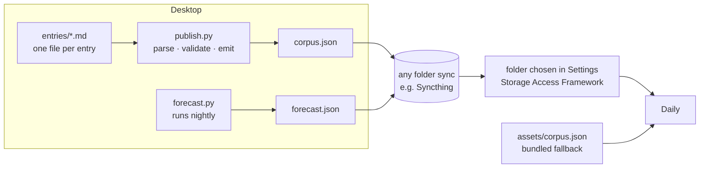

# Daily

**One substantial thing to think about, every day.** A small Android app that
serves one entry a day from a curated, hand-edited corpus of philosophy, sociology
and spirituality, with a scrollable timeline of past days and a private note under
each one.

Each entry is meant to be *worked through*, not skimmed: a few hundred to a
thousand words that develop one idea. It is written for the moments when you are
out and about with time to think and nothing to do.

[**Download the latest APK →**](https://github.com/Christian-H8/Daily/releases/latest)

<!-- TODO: two or three screenshots (Today, Timeline, Home) go here. -->

## What it does

| Screen | What's on it |
|---|---|
| **Today** | The day's entry, then your note on it |
| **Timeline** | Every past day, newest first, with month headers, note previews and a tag filter |
| **Reader** | One past day: the entry and the note you wrote that day |
| **Home** | The forecast drawn as sky: time-of-day gradient, cloud mass, rain |
| **Settings** | Notification time, corpus folder, notes backup and restore, forecast override, flick-to-turn, diagnostics |

- **A morning notification** (around 08:00 by default) shows the day's title and tagline.
- **Entries come in four shapes, so the format doesn't go stale:** *collision* (two
  ideas that undermine each other), *expound* (one line unpacked), *principle* (a
  claim built out and pressure-tested) and *passage* (an excerpt, closely read).
- **Navigation is a mechanical dial.** Swipe between sections. On phones with a
  gyroscope you can also turn on a quick twist of the wrist to do the same (off by
  default: *Settings → Flick to turn*).

## Install

Requires **Android 12 or newer**. The app is not on the Play Store, so you install
it from the APK (sideloading).

1. On your phone, download `daily-vX.Y.Z.apk` from
   [Releases](https://github.com/Christian-H8/Daily/releases/latest).
2. Open it, and allow your browser or file manager to install unknown apps when
   Android asks.
3. Open Daily and allow notifications.
4. **For a reliable morning notification**, exempt Daily from battery optimisation:
   *Settings → Apps → Daily → Battery → Unrestricted* (the wording varies by
   manufacturer). Without this, some phones delay or drop the alarm.

**Updates** install over the existing app. Your notes are kept, because every
release is signed with the same key. If Android ever reports that the package
conflicts with an existing one, **do not uninstall** unless your notes are backed up
(below): uninstalling deletes the app's own copy. Open an issue instead.

**Back up your notes.** In *Settings → Corpus → Choose folder*, pick any folder on
the phone. Daily then saves a copy of your notes there as `daily-notes.json` every time
you write. That copy survives an uninstall, and *Settings → Notes backup → Restore from
folder* merges it back in. A restore never deletes a note: for each day, the most
recently edited version wins. If that folder is synced to a computer, the copy goes
with it.

**Checking a download.** Each release includes `SHA256SUMS.txt`. Compare it with:

```sh
sha256sum daily-vX.Y.Z.apk                     # Linux / macOS
certutil -hashfile daily-vX.Y.Z.apk SHA256     # Windows
```

## Privacy

The privacy rule is enforced by the manifest, not just stated in a policy.

- **No `INTERNET` permission.** The app has no network code and cannot send
  anything anywhere. The only permissions it requests are `POST_NOTIFICATIONS`
  and `RECEIVE_BOOT_COMPLETED` (so the alarm survives a reboot).
- **Notes never leave the phone over the network.** They are excluded from Google
  cloud backup (`res/xml/data_extraction_rules.xml`). The only copy the app makes is
  the `daily-notes.json` you opt into by choosing a folder. It writes that file and
  nothing else; whether it goes anywhere is up to whatever sync tool you point at the
  folder. A direct phone-to-phone transfer, by cable or Wi-Fi Direct, also carries the
  notes to a new device.
- **No analytics, no account, no activity log.** The app records nothing except the
  notes you write. It doesn't even store which entry you saw on a given day: that
  is recomputed from the date.
- **No location.** Weather comes from a file you put in the corpus folder (see
  below), not from a location lookup.

## How content gets in



- **Out of the box,** the app reads the corpus bundled in the APK and labels its
  source *bundled copy*.
- **To use your own corpus,** pick a folder in Settings that contains a
  `corpus.json`. Any sync tool that writes into a phone folder works. The app reads
  the file; it never fetches it. The format is the bundled
  [`app/src/main/assets/corpus.json`](app/src/main/assets/corpus.json): entries
  made of sections, sections made of `p` and `quote` blocks. Block kinds the app
  doesn't recognise are skipped rather than treated as errors, so a newer corpus
  never crashes an older app.
- **Weather is optional.** A `forecast.json` in the same folder gives Home its sky:
  `{"days":[{"date":"2026-10-10","condition":"rain","high":90,"low":77}],"hours":[…]}`,
  where condition is one of `clear`, `cloud`, `rain`, `storm`, `fog` or `snow`.
  Without the file, Home falls back to time of day.

The authoring pipeline (`publish.py`, `forecast.py`) lives with the author's notes
rather than in this repo.

## Engineering notes

- **Ports and adapters with one hard rule:** `domain` imports nothing from Android,
  Compose or I/O. Selection and timeline reconstruction are pure functions, tested on
  the JVM in milliseconds.
- **Deterministic selection.** The day's entry is a pure function of the date and the
  corpus, using an FNV-1a 64 stable hash. The same algorithm runs in Python on the
  desktop, and a shared fixture keeps the two in agreement, so the author can preview
  any future date before the phone gets there.
- **Dependency-light on purpose.** No DI framework, navigation library, JSON library,
  HTTP client or database. Notes are one JSON file, written atomically through a temp
  file. Every dependency is a future upgrade obligation.
- **Degrade, never block.** No folder chosen, an unreadable corpus, no forecast: each
  failure falls back to something that still shows the day's entry. A secondary system
  must never cost the morning read.
- **Over 100 JVM unit tests**, including the selection-agreement test, corpus parsing
  (unknown block kinds included), note storage and migration, the flick detector, and
  the full screen-state class with no Robolectric.

Code comments cite requirement and decision IDs (`[R9.2b]`, `D-012`, …). They resolve
in [`docs/`](docs/README.md): the requirements, the design spec, the decision log and the
architecture diagrams.

## Build from source

Use Android Studio with the bundled JDK. Gradle provisions the JDK 25 toolchain
itself if it's missing.

```sh
./gradlew testDebugUnitTest      # unit tests
./gradlew installDebug           # installs as com.christianh.daily.dev
```

The debug build is a separate package (`.dev`), so it installs next to a release
copy without touching it or its notes.

### Cutting a release

Releases are built by [GitHub Actions](.github/workflows/release.yml). Pushing a tag
`vMAJOR.MINOR.PATCH` runs the unit tests, builds the release APK, signs it, checks the
signature, and attaches the APK and its checksum to a GitHub Release. The version code
is derived from the tag (`v1.2.3` → `10203`), so it only ever goes up.

```sh
git tag v1.0.0 && git push origin v1.0.0
```

The signing key comes from four repository secrets: `DAILY_KEYSTORE_BASE64`,
`DAILY_KEYSTORE_PASSWORD`, `DAILY_KEY_ALIAS` and `DAILY_KEY_PASSWORD`. The workflow
refuses to publish if they are missing, rather than shipping an APK signed with a
throwaway key that could never update an existing install.

## License

- **Code:** [MIT](LICENSE).
- **Corpus text** (`app/src/main/assets/corpus.json`):
  [CC BY-NC 4.0](LICENSE-CORPUS.md). Quoted passages inside entries belong to their
  authors and translators and are attributed where they appear.
