# Daily App — Architecture Diagrams

> **Public copy.** Generated from the project's private design documents with personal context removed (see [README](README.md)). IDs such as `[R8.2]`, `D-028` and `§6.2` resolve within these six documents; references to the scope document and the content backlog point at documents that are not published.

Detailed structure: classes, signatures, data shapes, and the paths through them. [SDS](SDS.md) §2.1 carries the one-box-per-layer version; this is the same system with the lids off.

**Everything here is in the build as of 2026-09-14.** Nothing is marked `(planned)` any more — notes, Home, Settings and the forecast landed on 2026-09-14 (D-020, D-021). What remains unbuilt is listed in §10 and is unbuilt *by requirement*, not by omission.

---

## 1. domain — pure Kotlin, imports nothing

The dependency rule: `domain` imports nothing from Android, Room, Compose, or the network. This is what makes selection and timeline reconstruction testable on the JVM in milliseconds, and what lets the same algorithm be re-implemented in Python and diff-tested ([SRS](SRS.md) [R2.6]).

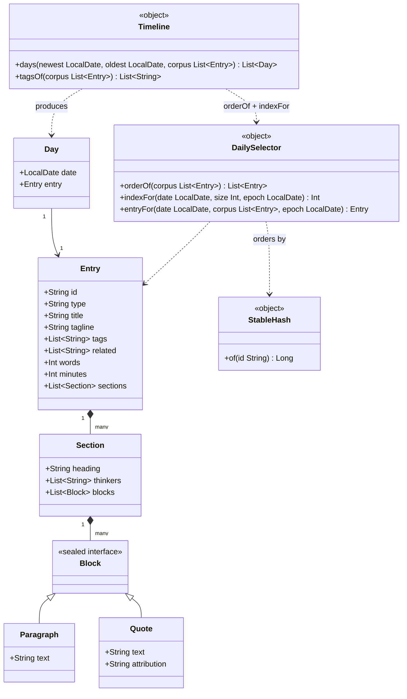

**`EPOCH`** is a top-level `val` beside `DailySelector`: `LocalDate.of(2026, 1, 1)`. Fixed forever — changing it shifts every future day.

**Why `orderOf` and `indexFor` are public.** `entryFor` is composed from them, but the timeline needs 255 days at once and calling `entryFor` per day would sort the corpus 255 times. Splitting them lets the timeline sort once. `entryFor`'s behaviour is unchanged and pinned by test.

**Why `Block` is sealed.** The renderer's `when` is exhaustive, so adding a kind is a compile error rather than a silent blank on the screen. The *loader* is deliberately more forgiving — an unknown kind in the JSON is skipped, because the corpus ships ahead of the client.

---

## 2. Data layer

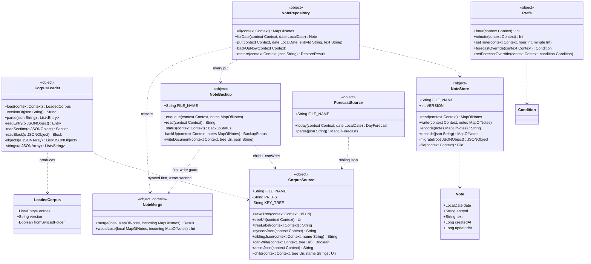

**Notes are a JSON file, not Room (D-020).** Room's compile-checked SQL, `Flow` observability, indexed queries and `MigrationTestHelper` are all for a scale this will not reach — the design ceiling is **999 notes**, one writer, no joins. The cost was KSP, an annotation processor version-locked to every Kotlin release, which is the upgrade obligation [NFR5] exists to refuse. `NoteStore` carries the migration path [R10.5] requires in about twenty lines. Its format is the plain text [R8.1] asked for, but its location is app-private, so the export is `NoteBackup`'s copy in the chosen folder (D-028).

`NoteRepository` is the boundary, so swapping in Room later touches one file — the ports-and-adapters argument cashed in for the second time, after `CorpusSource` in D-010.

**`parse()` takes a `String` and returns domain types** — no Android import anywhere in it. That is what makes it testable off-device, and `org.json` is on the test classpath so it actually is tested — 7 cases in `CorpusLoaderTest`.

**`syncedJson()` cannot throw.** Every failure returns null and `load()` falls back to the bundled asset. Eight in the morning is not the time to surface a `SecurityException`.

**`child` uses `DocumentsContract` directly** rather than `androidx.documentfile` — about twenty lines against a permanent dependency.

---

## 3. Data model — what is actually persisted

Five storage locations with completely different durability, which is the single most important thing about this diagram.

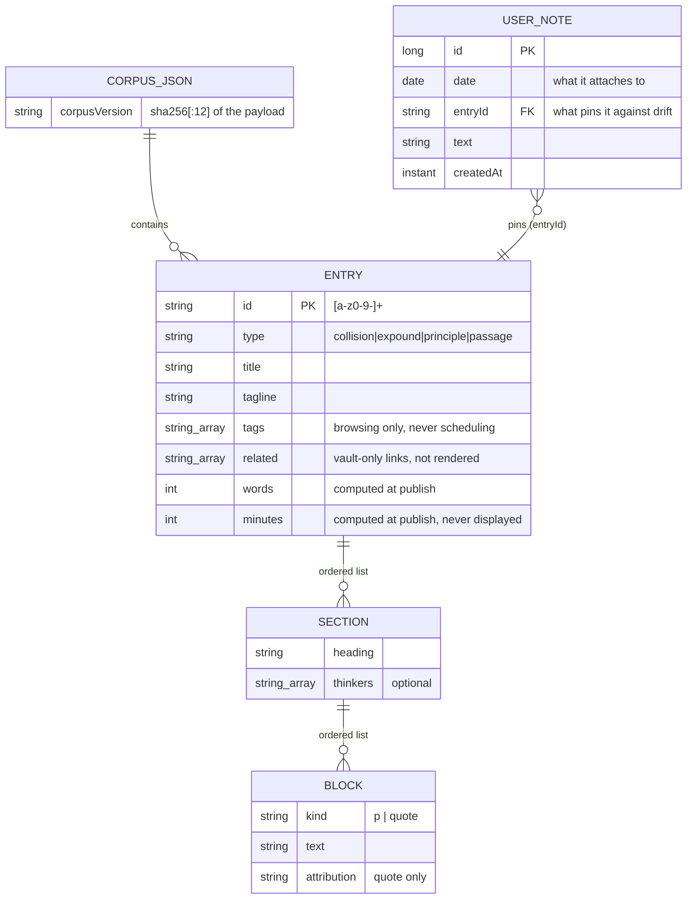

| Store | Durability | On schema change |
|---|---|---|
| `corpus.json` in the synced folder | **Disposable.** Regenerated from markdown by `publish.py`. | Re-read. Nothing to migrate. |
| `assets/corpus.json` in the APK | **Disposable.** A snapshot for first run and fallback. | Rebuild. |
| `forecast.json` in the synced folder | **Disposable.** Written by the desktop, several days ahead. | Re-read. Absent is the normal case. |
| `notes.json` in app-private storage | **Durable. The only non-recoverable data in the app.** | `NoteStore.VERSION` + `migrate()`, one step per bump. An unrecognised future version is read as-is, never discarded. |
| `daily-notes.json` in the chosen folder | **The off-device copy (D-028).** Same format as `notes.json`, rewritten on every note write; survives an uninstall. | Read through `NoteStore.decode`, so it migrates the same way. |
| `SharedPreferences` | **Disposable.** Notification time, forecast override, corpus folder URI. | Defaults. No user content. |

Writes to `notes.json` go through a temp file and a rename, so a half-written file — the one failure in this app that loses something unrecoverable — cannot happen.

**A note carries both `date` and `entryId` on purpose.** The date is what it attaches to ([R10.1]); the entry id is what pins the timeline row against drift ([R5.8]) — because the permutation derives from corpus size, publishing new entries changes what a past date computes to, and a note is the only thing that records what was actually there.

---

## 4. UI — composable graph

Compose has functions rather than classes, so this is a call graph.

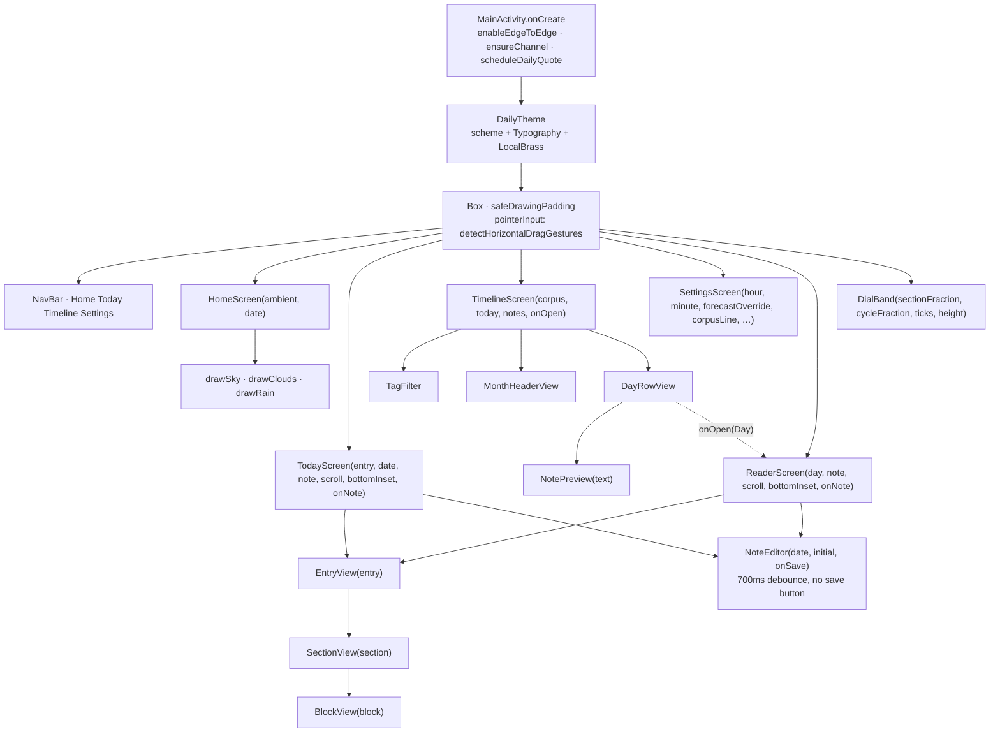

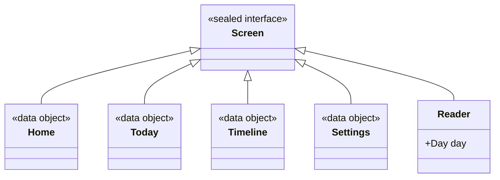

`SECTIONS = [Home, Today, Timeline, Settings]` is the ordered list on the dial's arc, sitting at 0, ⅓, ⅔ and 1. `sectionIndex()` maps a screen to a position, `asFraction()` spreads the list across `[0,1]`. **`Reader` is not on the arc** — it inherits the timeline's position, because it is reached from there.

Adding a section is one entry in `SECTIONS` and one branch in the `when`. The arc subdivides itself.

**`Reader` carries a `Day`, not an `Entry`.** A note attaches to a day ([R10.1]), and the same entry returning in 27 days is a different day with its own note — carrying only the entry made that impossible to express.

### Dial internals

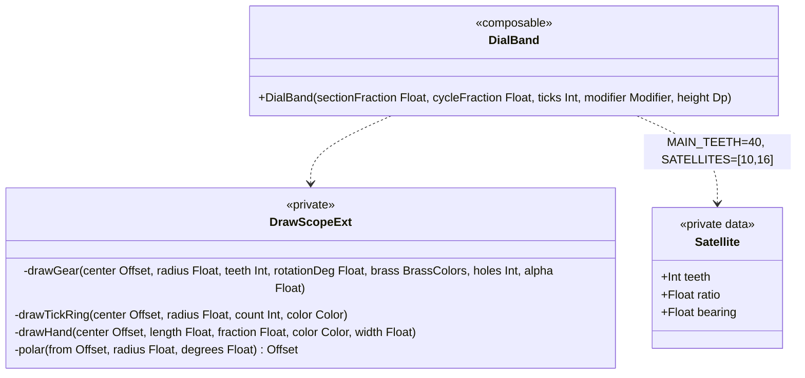

### Theme

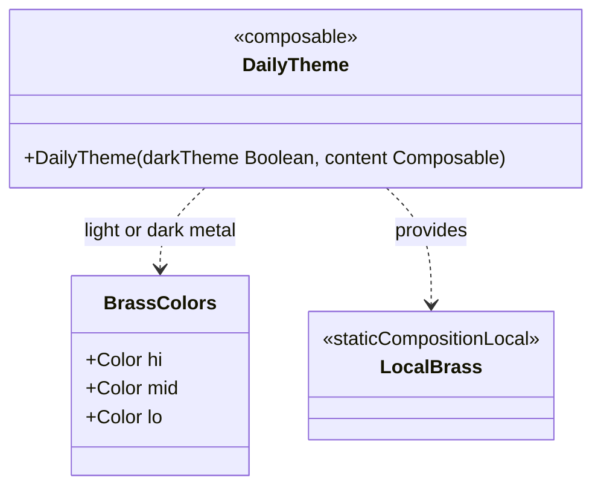

`BrassColors` exists because the Material scheme has no slot for gear metal. Three stops so each gear carries a gradient and reads as a lit surface rather than a flat shape.

---

## 5. Alarm and notification

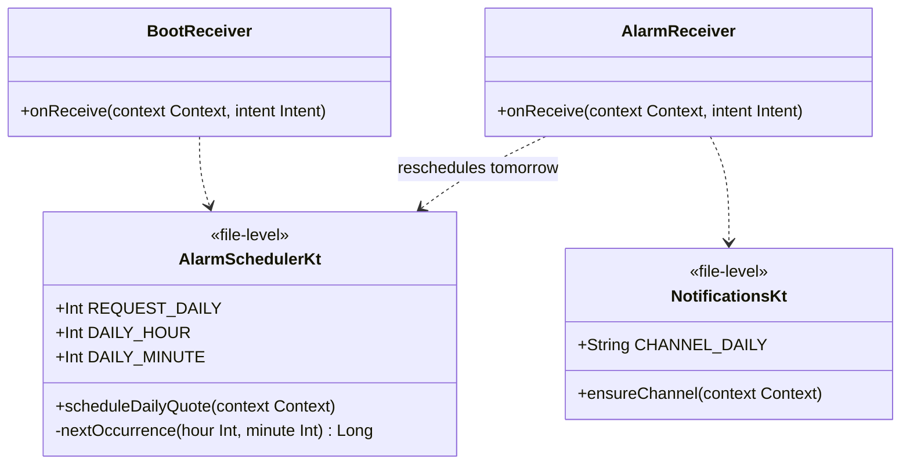

**`bigTextFor(entry)`** is a private top-level function in `AlarmReceiver.kt`: tagline, then the hook — the first quote with its attribution, or the opening paragraph. **No reading time** ([R3.9], [P6]).

---

## 6. The morning path

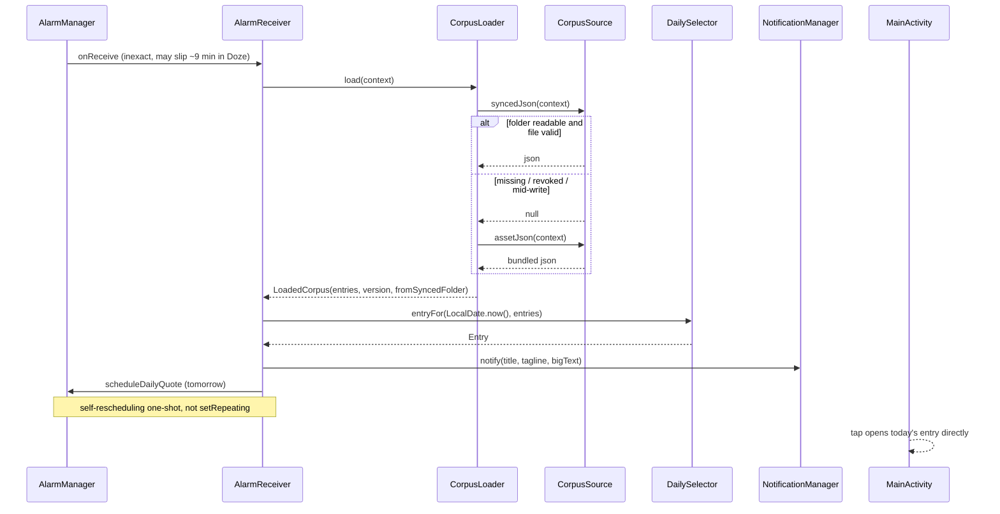

**The receiver reschedules before it finishes**, so a missed notification costs one day rather than every day after it.

**Delivery, not punctuality, is the bar** (D-013). `setAndAllowWhileIdle` is subject to a documented ~9-minute per-app Doze throttle — and so is `setExactAndAllowWhileIdle`, which is the correction recorded in D-011. Only `setAlarmClock` escapes it, and that shows a system alarm icon, which is a stronger claim on the device than a reading prompt deserves.

---

## 7. Corpus publish and distribution

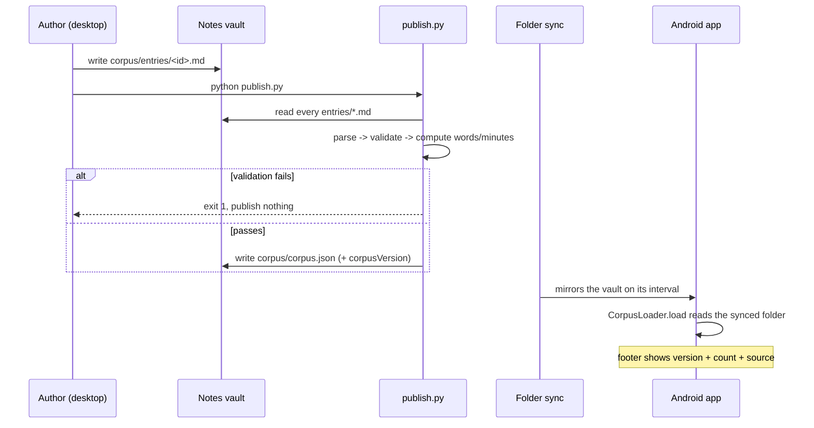

**No network call is made by the phone at any point.** There is no HTTP client, no `INTERNET` permission, and nothing to audit — which is [NFR3] achieved structurally rather than by policy.

**`corpus.json` lives beside the markdown it came from**, so the existing sync job carries it with no new configuration and no second channel.

---

## 8. The swipe

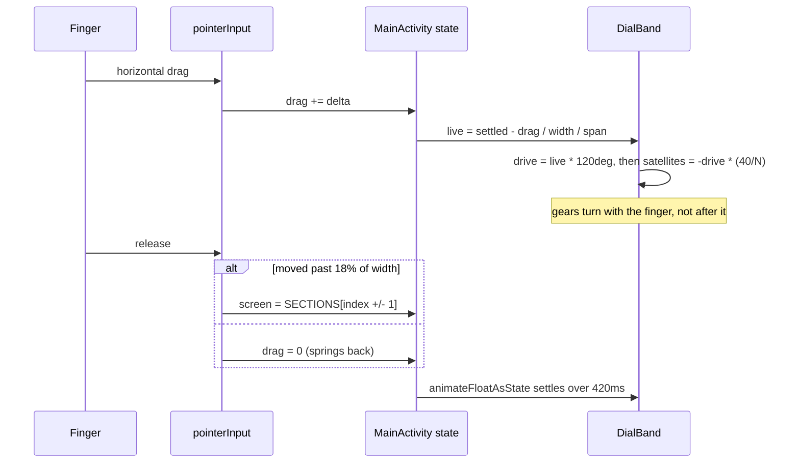

Horizontal deliberately — it never argues with the vertical scroll of an 800-word entry, and the vertical axis stays reserved for pulling Home up later ([R11.7]).

---

## 9. The cross-implementation contract

The one place two implementations of the same algorithm exist, and therefore the one place they can drift. D-007 was exactly this failure once already.

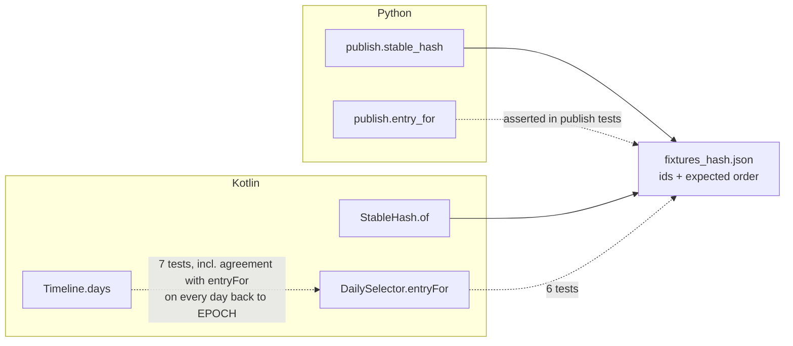

Three implementations of the ordering now exist, not two: `DailySelector.entryFor`, `Timeline.days`' sort-once fast path, and `publish.stable_hash` + `entry_for`. The fixture pins Kotlin against Python; the timeline agreement test pins the fast path against `entryFor`. **Both tripwires are necessary** — a silent divergence would mean the history shown contradicts the entry actually delivered.

---

## 10. What is not here

Absent by requirement, not by omission:

- **No network component.** D-010.
- **No search index, no graph traversal.** [R5.6] — the vault is the graph.
- **No Room, no SQLite.** D-020 — ~365 rows a year, one writer, no joins. `NoteStore` carries the migration path in twenty lines; KSP would carry a version lock to every Kotlin release.
- **No ViewModel, no DI container.** [SDS](SDS.md) §2.3. Notes were the expected trigger and turned out not to be one — `NoteRepository` is an object with a map, and screen state still survives nothing that matters. The trigger is now whatever first needs to outlive the composition.
- **No activity, history, or daily-pick table.** [P5], D-004. Encounter history is derivable from notes, which is the record without the surveillance.
- **No markdown parser in the client.** The publish step emits structured blocks; the client never sees markdown.
- **No animation on the weather.** [R9.4] — falling rain and lightning are the most expensive piece and the most likely to look cheap. Home draws sky, cloud and static rain and stops.
- ~~**No export code.**~~ Reversed by D-028. `notes.json` had the right format in the wrong place: app-private storage is invisible to the sync client. `NoteBackup` writes the copy into the chosen folder.

---

## Related
- [SDS](SDS.md) — the design this diagrams, §2.2 for the package tree
- [SRS](SRS.md) — the requirements each element traces to
- [SCHEMA](SCHEMA.md) — the authoring and publish formats
- [DESIGN](DESIGN.md) — visual and interaction design
- [DECISIONS](DECISIONS.md) — D-001 … D-028
